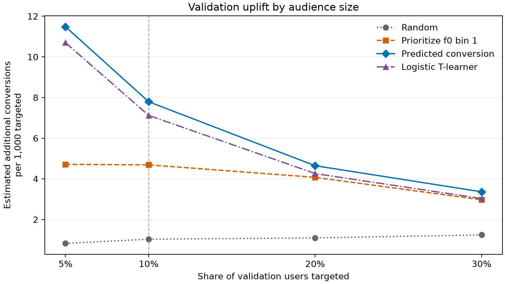

# Campaign uplift modeling

Exploratory analysis and targeting baselines using the Criteo uplift dataset.
The project measures conversion and visit uplift from campaign assignment,
examines differences between user segments, and compares targeting policies
on separate validation and test sets.

The strongest tested policy ranks users by predicted campaign conversion
probability. At a 10% test audience, it estimates **8.67 additional conversions
per 1,000 targeted**, compared with **7.17** for the logistic T-learner and
**1.42** for random selection. These are evaluation estimates, not a profit forecast.



Read the [analysis notebook](notebooks/criteo_uplift_analysis.ipynb) for code and saved results,
or the [findings](reports/criteo_uplift_findings.md) for the interpretation and limitations.

## Repository layout

```text
.
├── data/
│   ├── README.md                               # Input and generated-data instructions
│   ├── raw/                                    # Downloaded CSV, ignored by Git
│   └── processed/                              # Generated Parquet splits, ignored by Git
├── notebooks/
│   └── criteo_uplift_analysis.ipynb            # Annotated analysis with saved outputs
├── reports/
│   ├── criteo_uplift_findings.md               # Main results and caveats
│   └── figures/
│       └── validation_uplift_by_audience_size.png
├── scripts/
│   └── prepare_criteo_splits.py                # Deterministic split generation and checks
├── tests/
│   └── test_prepare_criteo_splits.py           # Synthetic split and failure-path checks
├── .gitattributes
├── .gitignore
├── .python-version
├── LICENSE                                     # MIT license for original code
├── pyproject.toml                              # Project dependencies
└── uv.lock                                     # Locked dependency versions
```

## Setup

Use Python 3.14 and [uv](https://docs.astral.sh/uv/). From the repository root:

```bash
uv sync --locked
```

This installs the analysis libraries, PyArrow for Parquet, and the IPython kernel.
The Python version matches the original environment. JupyterLab is optional;
VS Code with its Python and Jupyter extensions can run the notebook directly.

## Reproduce the analysis

1. Obtain `criteo-research-uplift-v2.1.csv.gz` and place it in `data/raw/`.
   See [data instructions](data/README.md) for the expected schema.
2. Optionally prepare the splits first:

   ```bash
   uv run --locked python scripts/prepare_criteo_splits.py
   ```

3. Open `notebooks/criteo_uplift_analysis.ipynb` in VS Code, select `.venv/bin/python` as the
   kernel, and run all cells in order. Paths work from the repository root or
   the `notebooks/` directory. The notebook also prepares splits when absent.

The input contains almost 14 million rows. Full execution scans the compressed
CSV several times, loads millions of rows into memory, and fits two logistic
regressions. Allow time and memory for the full dataset. The split-generation
step uses 500,000-row chunks, but later model fitting is not streaming.

For a JupyterLab interface, install it in a separate tool environment and
register the project kernel:

```bash
uv run --locked python -m ipykernel install --user --name campaign-uplift-modeling --display-name "Campaign uplift modeling"
uvx --from jupyterlab jupyter lab
```

### Reproducibility details

- Train, validation and test receive approximately 70%, 15% and 15% of rows.
- Splitting, subsampling and tie-breaking use seed 42.
- Training uses all control rows and a random 20% of campaign rows.
- Treatment and control models use scaled continuous inputs, one-hot encoded
  categorical inputs and logistic regression.
- Existing splits are checked for partition coverage, schema and row counts.
  Those checks do not prove source identity. Use a new output directory when
  changing the input or seed, for example `--output data/processed/new_splits`.
  Set the notebook's `SPLITS_DIR` to the same directory when evaluating those splits.
- The exported figure is written to `reports/figures/`.

The notebook has been executed top-to-bottom after refactoring, with fresh
tables and figures saved. Exact comparisons against a fresh run of the original
code confirmed all 16 result tables, fitted coefficients, test predictions,
audience rankings, chart values and printed statistics.

## Checks

Run the data-preparation checks without downloading the dataset:

```bash
uv run --locked python -m unittest discover -s tests -v
uv lock --check
```

The tests use a small synthetic CSV to check complete and disjoint membership,
deterministic results, cache reuse, incomplete-cache rejection and cleanup after
a failed build. They do not rerun the full statistical analysis.

## Before publishing

Commit the notebook, documentation, figure, scripts, `pyproject.toml` and
`uv.lock`. Raw data, generated splits, virtual environments, notebook checkpoints
and local credential directories are excluded by `.gitignore`.

In an initialized Git checkout, review the staged file list before committing:

```bash
git add .
git diff --cached --stat
git diff --cached --name-only
```

## License and attribution

Original Python and notebook code is available under the [MIT license](LICENSE).
The Criteo dataset is obtained separately under
[CC BY-NC-SA 4.0](https://creativecommons.org/licenses/by-nc-sa/4.0/).
The code license does not relicense Criteo data or adaptations covered by its
terms. See [data attribution and citation](data/README.md#license-and-citation).
