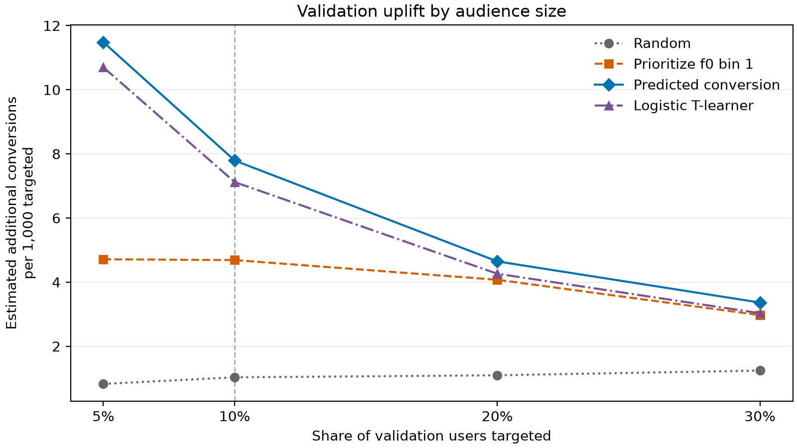

# Findings from the saved analysis

Source: [criteo_uplift_analysis.ipynb](../notebooks/criteo_uplift_analysis.ipynb).
The refactored notebook reproduces these results. A full execution and exact
comparison against the original code confirmed that the numerical results are
unchanged.

## Data quality and overall uplift

The full audit covers 13,979,592 rows and 16 columns. It finds no missing or
infinite values, invalid binary flags, exposed controls, or conversions without
visits. Duplicate users or records were not assessed.

Campaign users comprise 85% of rows; controls comprise 15%.

| Outcome | Control rate | Campaign rate | Uplift in percentage points | 95% confidence interval |
| --- | ---: | ---: | ---: | ---: |
| Conversion | 0.1938% | 0.3089% | +0.1152 | +0.1085 to +0.1219 |
| Visit | 3.8201% | 4.8543% | +1.0342 | +1.0056 to +1.0629 |

Overall conversion uplift corresponds to about 1.15 additional conversions per
1,000 campaign-assigned users. Only 3.604% of campaign users have recorded ad
exposure, so these estimates concern assignment rather than exposure.

## Balance and segment differences

Continuous-feature balance is close on the sampled rows, with maximum absolute
standardized mean difference of 0.0215. The dominant `f3` category represents
83.03% of controls and 81.66% of campaign users. Standardizing over that category
and all remaining categories reduces conversion uplift to +0.1060 percentage
points, approximately 8% below the unadjusted estimate. This is a two-group
sensitivity check, not a complete adjustment for possible confounding.

The lowest quartile of `f0` values above its minimum, approximately
`12.6164 < f0 <= 20.5817`, has training conversion uplift of +0.4548 percentage
points. Validation uplift is +0.4389, with a 95% interval of +0.3603 to +0.5176.
The highest `f0` bin has validation uplift of -0.0003 percentage points, with
an interval crossing zero.

## Targeting comparison

Each policy selects 10% of the relevant evaluation split. Values below are
estimated additional conversions per 1,000 targeted, calculated as 1,000 times
the selected audience's campaign conversion rate minus its control conversion
rate.

| Policy | Validation | Test |
| --- | ---: | ---: |
| Random | 1.03 | 1.42 |
| Prioritize strongest `f0` bin | 4.69 | 5.79 |
| Predicted campaign conversion | **7.79** | **8.67** |
| Logistic T-learner | 7.12 | 7.17 |

On test data, conversion ranking exceeds the T-learner by 1.51 additional
conversions per 1,000 targeted. A 5,000-replicate paired bootstrap gives a 95%
interval of 0.76 to 2.20. The bootstrap preserves overlap between the fixed
policies; it does not capture model-training or model-selection uncertainty.

Conversion ranking leads at every tested validation audience size, from 5% to
30%. Additional conversions per targeted user decline as the audience expands.
The chart has no uncertainty intervals, so it does not establish significant
differences at every audience size.

## Why the T-learner falls behind

The models' top test audiences overlap by 78.3%. Users selected only by the
conversion model have observed uplift of 7.66 per 1,000, compared with 0.50 for
users selected only by the T-learner. The T-learner predicts negative average
uplift for the first group. Segment calibration diagnostics suggest that errors
in the separate control and campaign predictions distort its ranking.

## Interpretation and next steps

Predicted campaign conversion is the strongest tested targeting benchmark for
this dataset. This does not establish that conversion models generally
outperform uplift models.

Interpreting observed rate differences causally assumes comparable treatment
and control groups and independent observations. Feature imbalance, anonymized
inputs and unassessed duplicate entities limit that interpretation. Estimated
additional conversions are conditional estimates rather than observed gains.

The test set has been used for exploratory diagnostics. Further tuning informed
by those diagnostics should use a fresh holdout for final evaluation. A useful
next experiment would address model calibration and assess a stronger uplift
model against the conversion baseline. Campaign costs and conversion values
are needed before selecting a profitable audience size.
